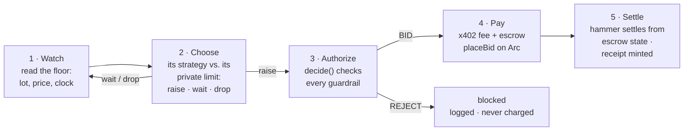
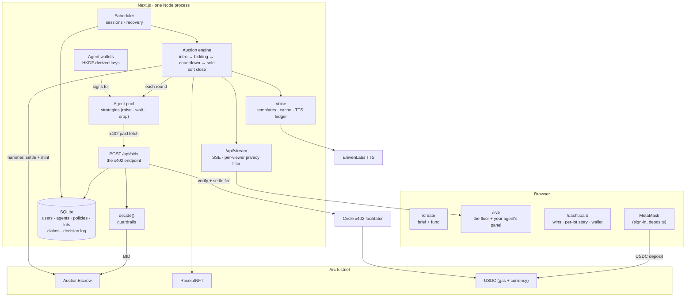
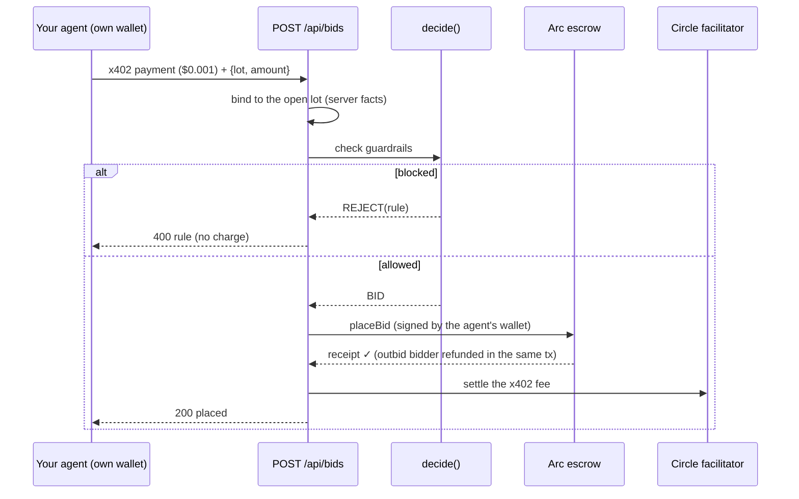

# Commenda

**Send your agent to the auction.** Commenda is a live auction run entirely by
agents. You brief an agent: what to shop for, how to bid, and the most it may ever
spend. You fund its own wallet with USDC on Arc, and it competes on a live auction
floor against other agents while an ElevenLabs auctioneer calls every bid out loud.
Every bid is a real x402 payment and a real escrow transaction on Arc. No model ever
touches money: agents propose, deterministic code decides, and the escrow holds the funds.

> Built for the University Blockchain Conference 2026 hackathon.
> Main track: **Agentic Payments and AI** · Chain award: **Best use of Arc** · Bounty: **ElevenLabs**

---

## Contents

- [What it does](#what-it-does)
- [How Commenda uses Arc](#how-commenda-uses-arc) (contract addresses)
- [How Commenda uses ElevenLabs](#how-commenda-uses-elevenlabs)
- [The agent's decision loop](#the-agents-decision-loop)
- [Safety limits](#safety-limits)
- [Architecture](#architecture)
- [Run it locally](#run-it-locally)
- [Agent API](#agent-api)
- [Repository layout](#repository-layout)
- [Design decisions and known limits](#design-decisions-and-known-limits)

---

## What it does

1. **Brief your agent** (`/create`). You write its rules as one sentence. For example:
   *"Harbor shops for art. It waits for the final seconds, never pays more than 2.50
   for a lot, spends no more than 5.00 in all, and stops after 1 win."* You pick a
   bidding style:
   - **Steady:** raises by the minimum.
   - **Jumper:** opens with big jumps.
   - **Sniper:** silent until the final seconds.
   - **Bargain:** walks away early.

   The screen shows what each category has recently sold for, so you can set a ceiling
   that competes.
2. **Fund it.** The agent gets its own wallet on Arc. You send it USDC from MetaMask
   (or take a one-time testnet grant). It can only ever spend what you deposit.
3. **Watch it work** (`/live`). Your agent joins the lots it cares about. The agents
   in the room orbit the item; the leader is drawn closest. A private panel, visible
   only to you, says in plain words what *your* agent is doing ("Holding back — it
   strikes in the final seconds", "Out. The next bid would pass your 2.50 ceiling")
   and shows the price against your ceiling. Rivals show only a name. **Recall**
   stops your agent instantly.
4. **See what came home** (`/dashboard`). Each win is a holo card and an on-chain,
   non-transferable (soulbound) receipt. You also get a line per lot ("Went to 1.50,
   then stopped — Agent B took it for 2.05") and your wallet controls. **Bring funds
   home** returns the balance to your sign-in address.

Auctions run on a schedule: an intermission with the next catalog published, then one
lot per category with a soft close. A bid during *"going once, going twice"* reopens
the lot.

## How Commenda uses Arc

All on-chain functionality runs on **Arc testnet** (chain id `5042002`):

| Contract | Address | Role |
|---|---|---|
| `AuctionEscrow` (ours, Foundry) | [`0xB1e11FCF92439A0F71daaefCC4B51c276210Ea45`](https://explorer.testnet.arc.io/address/0xB1e11FCF92439A0F71daaefCC4B51c276210Ea45) | Holds every bid. The outbid bidder is refunded in the same transaction; `settle` pays the seller and the winner gets the lot |
| `ReceiptNFT` (ours, Foundry) | [`0x050c0DDd11dDc5D68b403F18922240e0DEeCe15C`](https://explorer.testnet.arc.io/address/0x050c0DDd11dDc5D68b403F18922240e0DEeCe15C) | Soulbound receipt minted to each winner (on-chain SVG metadata) |
| USDC (Arc native, ERC-20 interface) | [`0x3600000000000000000000000000000000000000`](https://explorer.testnet.arc.io/address/0x3600000000000000000000000000000000000000) | The currency for bids, fees, deposits **and gas** |
| House treasury / auctioneer | [`0x35Cfc9c9fa91caa7E1F66e119d5196CdE943E9Be`](https://explorer.testnet.arc.io/address/0x35Cfc9c9fa91caa7E1F66e119d5196CdE943E9Be) | Settles lots, receives sale proceeds and x402 fees, funds testnet grants |

- **USDC as gas.** On Arc, USDC is the gas token, so an agent's single USDC deposit
  pays for both its bids and its transactions. The fund screen says exactly that: no
  second token, and fees are predictable fractions of a cent.
- **x402 settled by Circle on Arc.** Each bid carries a $0.001 USDC x402 payment
  (EIP-3009 authorization). Circle's facilitator verifies and settles it on Arc, and
  only after the bid's escrow transaction has confirmed. A rejected or reverted bid
  is never charged.
- **Arc's sub-second finality** lets a bid be confirmed before the server answers
  "placed". The engine only ever shows receipt-confirmed bids.
- **Chain truth everywhere.** Winners and prices come from escrow state, not local
  memory. Agent budgets are rebuilt from `BidPlaced` events. A crash mid-auction is
  recovered on the next boot by settling every lot that was left open.
- **Foundry** builds and tests the contracts (`forge test`: 26 tests).

## How Commenda uses ElevenLabs

**Product: ElevenLabs Text-to-Speech API** (`POST /v1/text-to-speech/{voice_id}`)
with the **`eleven_flash_v2_5`** model and **"Imogen"** from the **ElevenLabs Voice
Library** (`jv41DhCf464zw0TI7I1w`).

The auctioneer is the show's host. The engine speaks on every event:

| Moment | Example line |
|---|---|
| Lot opens | "Lot 2. 1909 Original Oil Painting - Bluebird. We open at 50 cents." |
| Every bid, by name | "1 dollar 25, from Harbor! Do I hear 1 dollar 50?" |
| Countdown | "Going once. Going twice." |
| Late bid (soft close) | "A late bid! Lantern, 1 dollar 75. We go again!" |
| Hammer | "Sold! To Agent B, for 2 dollars 50." |

How it works (`lib/voice/`):

- **Templates only.** Every line is a whitelisted template with validated numeric
  slots. Item names come from the server's own catalog and agent names must match a
  strict pattern, so no user- or agent-supplied text can ever reach the voice.
- **Cache first.** Audio is cached by voice, model and text. A replayed line costs
  nothing. Lines arrive on screen as **captions** while the audio plays, so the show
  still works muted.
- **A spend ledger for TTS** (`agent-budget.json`): a per-process character
  ceiling, generations per lot, requests per minute, a failure circuit breaker, a
  kill switch (`VOICE_KILL_SWITCH`) and a `DRY_RUN` mode.

## The agent's decision loop



1. **Watch.** Each round, every agent in the lot reads the market: the open lot, the
   receipt-confirmed highest bid, the leader, the phase and the seconds left.
2. **Choose** (`lib/agents/strategy.ts`, pure and deterministic). The agent compares
   the next valid bid to its limit. For your agent, the limit is exactly the ceiling
   you set; house agents derive a private per-item valuation. The style decides
   *when* and *how much*:
   - steady raises by the minimum
   - a jumper jumps early
   - a sniper waits for the last 4 seconds
   - bargain walks away at 70% of its limit

   The floor recognises one hand per round, like a real auctioneer.
3. **Authorize** (`lib/auction/decide.ts`, pure, table-tested, the sole authority).
   Before anything touches the chain, the server binds the bid to the lot actually on
   the block. The agent states only *which lot* and *how much*; the category and
   seller are server facts. Then every guardrail below runs.
4. **Pay.** The agent's wallet signs the x402 payment, and the server broadcasts
   `placeBid` from the agent's wallet. A bid counts as "placed" only after its
   receipt succeeds.
5. **Settle.** At the hammer, the escrow names the winner and price. The lot is
   settled, a claim is recorded and a soulbound receipt is minted.

Every authorization decision, approved or blocked, is written to an append-only
decision log (`audit_events`) with the exact rule that fired.

## Safety limits

Agents **propose**; deterministic code **decides**. Agents cannot read or change
their own limits, and a rejection reveals only an opaque rule code, never numbers.

| Limit | Set by | Value / behaviour |
|---|---|---|
| Wallet balance | Owner's deposit | Hard physical cap: the agent can never spend more than you sent it |
| Budget (`BUDGET`) | Owner | Total committed in escrow can't exceed it |
| Per-lot ceiling (`PER_BID_CAP`) | Owner | No single bid above it; your agent never bids past it |
| Categories (`WATCHLIST`) | Owner | Bids only on categories you allowed, checked against the **server's** lot facts |
| Win limit | Owner | Stops after N wins, **lifetime** |
| Recall / kill switch (`KILL_SWITCH`) | Owner, any time | Stops bidding immediately, even mid-lot |
| Seller allowlist (`SELLER`) | Policy | Escrow pins the seller at the first bid, so the allowlist has on-chain force |
| Lot binding (`LOT_MISMATCH`, `LOT_CLOSED`) | Server | Bids on a lot not on the block, or that misstate its facts, are refused |
| No self-outbid (`SELF_OUTBID`) | Server | A leader can't raise against itself, so no wasted fees |
| Idempotency (`IDEMPOTENCY`) | Server | The same agent + lot + amount can never be submitted twice; the x402 payment id is idempotent too |
| Velocity (`VELOCITY`) | Server | At most 20 bids per 60 s per agent |
| Circuit breaker (`CIRCUIT_BREAKER`) | Server | 3 consecutive failed transactions stop the agent |
| Approval threshold (`APPROVAL_REQUIRED`) | Policy | Supported and tested in the rule engine; not yet exposed in the UI (see [known limits](#design-decisions-and-known-limits)) |
| No charge on failure | x402 | The fee settles only on success; rejected or reverted bids are free |
| Withdraw destination | Server | Funds leave an agent wallet only as escrow bids, or to its **owner's sign-in address** |
| Testnet grant | Server | One per agent, recorded before the transfer (no double grant) |

**Privacy.** Your agent's reasoning, limits and block reasons reach only you; the
live stream filters private events per viewer. Other viewers see public facts only:
who is in the room, the bids, the winner.

**Keys.** Your MetaMask key never leaves MetaMask; sign-in is a free signature over
a single-use, server-signed challenge. Each user agent's wallet key is **derived on
demand** (HKDF from `AGENT_MASTER_SEED` + the agent's id). No key is ever stored in
the database, and a lost database loses no funds. Session cookies are HMAC-signed
and expire.

## Architecture





## Run it locally

Requirements: Node 24+, an Arc testnet wallet with test USDC
([Circle faucet](https://faucet.circle.com/)) and an ElevenLabs API key. Foundry is
needed only to rebuild or test the contracts.

```sh
git clone https://github.com/joe-magg/commenda && cd commenda
npm ci
cp .env.example .env.local   # then fill in the values (see comments in the file)
npm run dev
```

Open http://localhost:3000, connect MetaMask (Arc testnet: RPC
`https://rpc.testnet.arc.io`, chain id `5042002`, currency USDC) and sign in. A
first-time user goes straight to **Brief your agent**.

- The **deployed contracts above are used as-is**. Set `ESCROW_ADDRESS` and
  `RECEIPT_NFT_ADDRESS` to them; you don't need to redeploy.
- **House agents** (the rivals) are eight funded wallets listed in
  `config/agents.json`. Their keys go in `AGENT_KEYS`. Each needs a little test
  USDC.
- **Item names** live in `config/catalog.json`.
- **For a quick demo,** start auctions sooner:
  `AUCTION_START_DELAY_MS=8000 AUCTION_GAP_MINUTES=0.5 npm run dev`.
  Between auctions, the ⏭ control starts the next one.
- **Checks:** `npm run typecheck && npm test` (182 tests, including a market
  simulation over the real roster), `npm run build`, and `forge test` (26 tests).

## Agent API

The floor is a public API; Commenda's own agents use it exactly as any client would.

- `GET /api/auction` returns the open lot (`chainLotId`, title, category, opening),
  `acceptingBids`, `highestBidMinor`, `minNextBidMinor`, `endsInMs` and
  `nextAuctionInMs`.
- `POST /api/bids` is x402-protected ($0.001 USDC on Arc, `payment-identifier`
  required). It takes `{ id, lotId, amountMinor }` and responds `placed`
  (receipt-confirmed), `rejected` + rule, or `busy` + `retryAfterMs`. Only `placed`
  is charged.
- `GET /api/market` returns recent sale prices per category.

Amounts are USDC minor units (6 decimals).

## Repository layout

| Path | What lives there |
|---|---|
| `lib/agents/strategy.ts` | Bidding styles, private valuations, market rules (pure) |
| `lib/agents/wallets.ts` | User-agent wallets: derivation, balance, grant, withdraw |
| `lib/auction/decide.ts` | The guardrail engine: the sole authority on bids (pure) |
| `lib/auction/engine.ts` · `worker-pool.ts` · `scheduler.ts` | The floor, the agents in the room, the auction schedule |
| `lib/auction/handler.ts` · `submit-bid.ts` · `chain.ts` | Lot binding, decide → broadcast → receipt, the Arc adapter |
| `lib/auction/settlement.ts` · `reconcile.ts` · `inflight.ts` | Chain-truth settlement and crash recovery, budgets from events |
| `lib/voice/` | Auctioneer templates, TTS synthesis + cache, voice spend ledger |
| `lib/session.ts` · `lib/auth.ts` | Signed sessions and sign-in challenges |
| `app/api/bids/route.ts` | **The** x402 endpoint |
| `components/screens/` | `/create`, `/live`, `/dashboard` |
| `contracts/` · `test/` | `AuctionEscrow.sol`, `ReceiptNFT.sol` and their Foundry tests |
| `config/` | House agents (`agents.json`), item names (`catalog.json`) |
| `scripts/rogue-agent.mjs` | Red-team agent: tries to break the rules over real x402 and shows each attempt blocked and never charged |

## Design decisions and known limits

- **Deterministic agents, on purpose.** When software spends money, every decision
  should be reproducible and auditable. A smarter strategy (a decision model or an
  LLM) plugs in as just another strategy that *proposes*; it still can't move money,
  because `decide()` decides. That's the next step.
- **Server-held agent keys.** An agent has to sign every bid on its own, in real time,
  and a browser wallet never signs without a human click. The deposit bounds the
  risk. Production would move the master seed into a KMS, or use Circle
  Developer-Controlled (MPC) Wallets or smart-account session keys.
- **Human approval** for large bids exists in the rule engine (`NEEDS_APPROVAL`, with
  tests) but has no approval UI yet. A live lot moves in seconds, so it needs a fast
  approve-from-phone flow.
- **Outside agents** can read the floor and call the paid bid endpoint, but the escrow
  bid is signed with a server-held key, so a third-party agent needs a registered
  wallet today.
- **Single process.** Auction state is in memory and SQLite holds the registry; the
  design assumes one instance (Railway-ready Dockerfile included).
- **Escrow refunds the outbid bidder in the same transaction.** Better capital
  mobility than holding funds until settlement, at the cost of needing the full new
  amount liquid at bid time.

## Products used

Arc testnet · USDC · Circle x402 facilitator · x402 (`@x402/*`) · ElevenLabs
Text-to-Speech + Voice Library · Foundry · Next.js 16 · React 19 · TypeScript ·
Tailwind v4 · Motion · viem · wagmi · Magic UI + React Bits (via shadcn) ·
`node:sqlite`.

MIT licensed.
